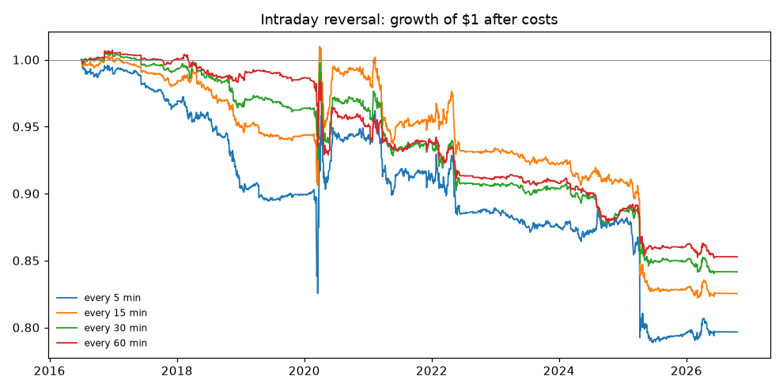

# Intraday backtest

500 stocks, 5-minute bars, 2016-07-01 to 2026-10-19 (2589 sessions). Walk-forward ridge refit monthly; trades at the next bar's open; flat every night.

**every 5 min: Sharpe -0.48** after costs (0.55 before), -2.1%/yr, max drawdown -21.2%, deflated-Sharpe probability 1%. Edge 1.25 bp per dollar traded vs. cost 2.34 bp. Mean out-of-sample IC 0.0099.

## Rebalance interval and costs

| variant | Sharpe | pre-cost | 1st half | 2nd half | return/yr | cost/yr | turnover/day | trades/day |
|---|---|---|---|---|---|---|---|---|
| every 5 min | -0.48 | 0.55 | -0.32 | -0.71 | -2.1% | 4.6% | 0.8x | 92 |
| every 5 min (costs not charged) | 0.55 | 0.55 | 0.76 | 0.27 | 2.4% | 0.0% | 0.8x | 92 |
| every 15 min | -0.52 | 0.20 | -0.20 | -0.94 | -1.8% | 2.5% | 0.4x | 43 |
| every 15 min (costs not charged) | 0.20 | 0.20 | 0.57 | -0.29 | 0.7% | 0.0% | 0.4x | 43 |
| every 30 min | -0.55 | -0.01 | -0.33 | -0.97 | -1.6% | 1.6% | 0.3x | 26 |
| every 30 min (costs not charged) | -0.01 | -0.01 | 0.23 | -0.42 | -0.0% | 0.0% | 0.3x | 26 |
| every 60 min | -0.61 | -0.22 | -0.39 | -1.12 | -1.5% | 1.0% | 0.2x | 14 |
| every 60 min (costs not charged) | -0.22 | -0.22 | 0.00 | -0.69 | -0.5% | 0.0% | 0.2x | 14 |
| every 5 min, costs x0.5 | -0.89 | 1.18 | -0.35 | -1.46 | -6.7% | 15.8% | 4.4x | 490 |
| every 5 min, costs x2 | -0.40 | 0.13 | -0.21 | -1.00 | -0.7% | 0.9% | 0.1x | 13 |

## By year

| year | return | pre-cost | cost | Sharpe | turnover/day | OOS IC |
|---|---|---|---|---|---|---|
| 2016 | -1.1% | 0.1% | 1.2% | -1.28 | 0.3x | 0.0206 |
| 2017 | -2.3% | -1.0% | 1.3% | -2.14 | 0.2x | 0.0184 |
| 2018 | -6.5% | -1.2% | 5.3% | -2.52 | 0.9x | 0.0172 |
| 2019 | -0.7% | 0.8% | 1.5% | -0.47 | 0.3x | 0.0128 |
| 2020 | 5.3% | 18.0% | 12.7% | 0.51 | 1.9x | 0.0119 |
| 2021 | -2.9% | 4.3% | 7.2% | -0.84 | 1.2x | 0.0168 |
| 2022 | -2.8% | 0.2% | 3.0% | -0.73 | 0.5x | 0.0106 |
| 2023 | -1.6% | 0.2% | 1.7% | -1.14 | 0.3x | 0.0131 |
| 2024 | 0.7% | 5.5% | 4.9% | 0.31 | 0.9x | 0.0153 |
| 2025 | -9.9% | -2.8% | 7.1% | -1.50 | 1.3x | 0.0114 |
| 2026 | 0.1% | 1.0% | 0.9% | 0.09 | 0.2x | 0.0054 |

## Latest model (2026-10)

| feature | weight |
|---|---|
| rev_1@open | +0.0042 |
| rev_3@open | -0.0044 |
| rev_12@open | +0.0025 |
| day_ret@open | +0.0054 |
| gap@open | +0.0031 |
| vwap_dev@open | +0.0006 |
| abn_vol@open | +0.0004 |
| rev3_lowvol@open | -0.0028 |
| rev_1@mid | +0.0017 |
| rev_3@mid | -0.0019 |
| rev_12@mid | +0.0024 |
| day_ret@mid | -0.0005 |
| gap@mid | -0.0028 |
| vwap_dev@mid | -0.0023 |
| abn_vol@mid | +0.0033 |
| rev3_lowvol@mid | -0.0004 |
| rev_1@close | +0.0004 |
| rev_3@close | +0.0002 |
| rev_12@close | -0.0044 |
| day_ret@close | -0.0074 |
| gap@close | -0.0010 |
| vwap_dev@close | +0.0037 |
| abn_vol@close | +0.0036 |
| rev3_lowvol@close | +0.0014 |
