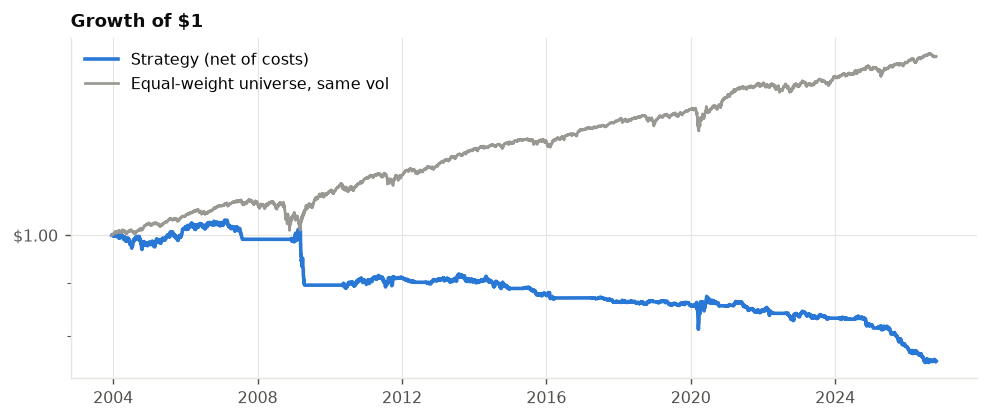
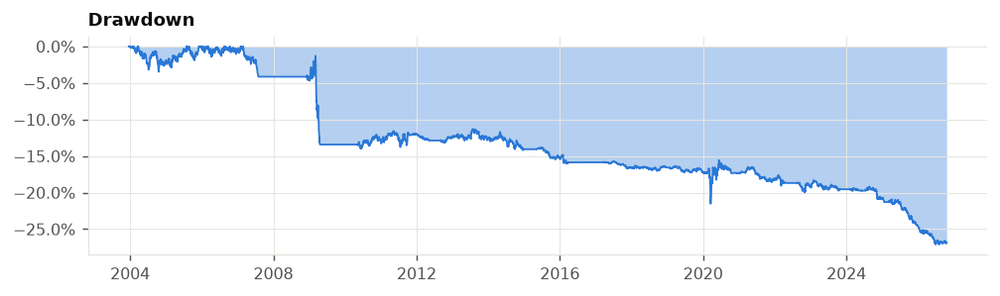
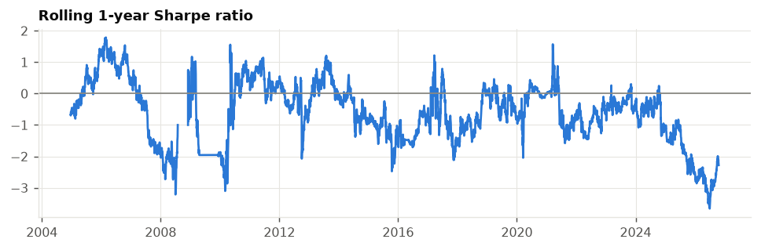
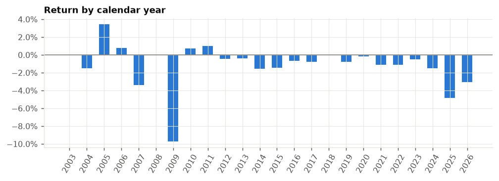
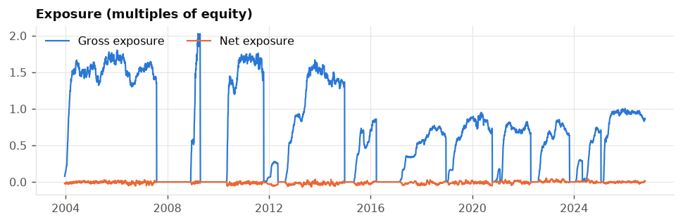
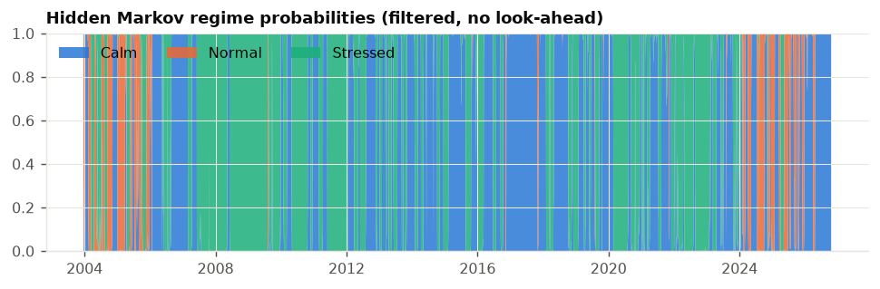
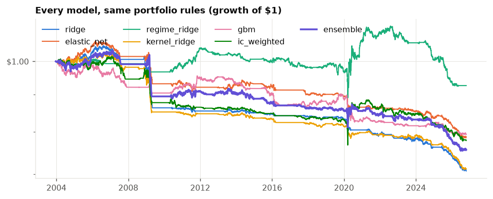
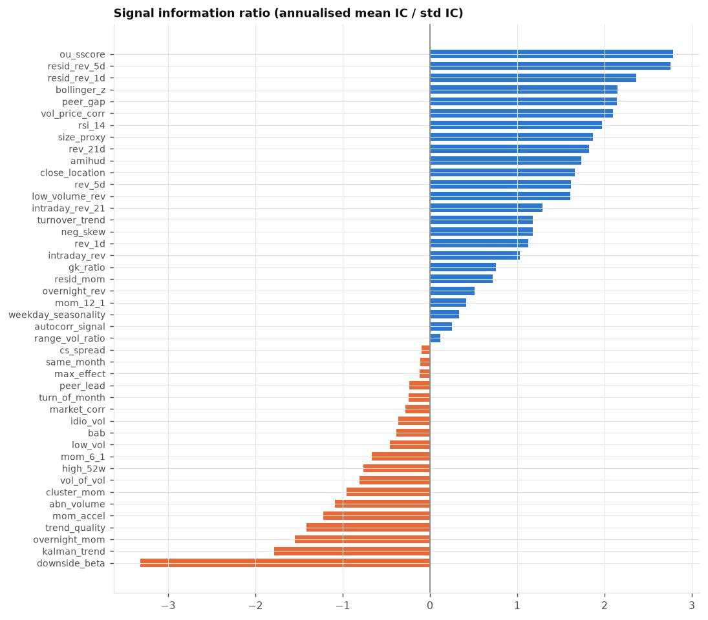
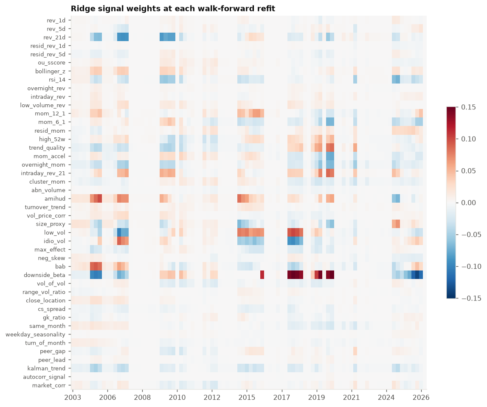

# Backtest results

| | |
|---|---|
| Period | 2003-12-19 to 2026-10-19 (22.8 years) |
| Stocks / signals | 1000 / 44 |
| Traded model | ensemble |
| Sharpe ratio | -0.54 |
| Annual return | -1.2% |
| Annual volatility | 2.2% |
| Max drawdown | -27.1% |
| Deflated Sharpe probability | 0.0% |
| Beta / correlation to market | 0.01 / 0.05 |
| Avg gross exposure | 0.74x |
| Annual turnover | 17x |
| Cost + borrow drag / yr | 1.5% |

> **Read these results with care.** The universe is today's largest companies that have traded for 15+ years, tested over the past - so it never holds a company that later failed or shrank (survivorship and look-ahead bias). Expect live results to be weaker.
>
> Everything else is out-of-sample: signals use only past data, models are refit walk-forward, trades fill at the next day's open, and spread, market impact and borrow fees are charged.
>
> The **deflated Sharpe** is the probability the true Sharpe is above zero after correcting for having tried every model on this page. Below ~95% the edge is not statistically convincing.
>

## Models (same portfolio rules)

| model        |   sharpe |   ann_return |   ann_vol |   max_drawdown |   ann_turnover |   ann_cost_drag |   mean_ic |
|:-------------|---------:|-------------:|----------:|---------------:|---------------:|----------------:|----------:|
| regime_ridge |   -0.099 |       -0.003 |     0.029 |         -0.173 |         20.332 |           0.015 |     0.01  |
| ic_weighted  |   -0.451 |       -0.011 |     0.024 |         -0.245 |         16.288 |           0.012 |     0.01  |
| gbm          |   -0.459 |       -0.01  |     0.022 |         -0.208 |         22.821 |           0.018 |     0.013 |
| elastic_net  |   -0.535 |       -0.01  |     0.019 |         -0.263 |         14.669 |           0.012 |     0.005 |
| ensemble     |   -0.538 |       -0.012 |     0.022 |         -0.271 |         17.373 |           0.014 |     0.011 |
| kernel_ridge |   -0.729 |       -0.015 |     0.02  |         -0.308 |         16.092 |           0.013 |     0.006 |
| ridge        |   -0.73  |       -0.015 |     0.021 |         -0.327 |         12.355 |           0.01  |     0.002 |

## Portfolio-construction diagnostics (same ensemble forecast)

| variant                        |   sharpe |   sharpe_1st_half |   sharpe_2nd_half |   ann_return |   ann_vol |   pre_cost_sharpe |   avg_gross |   ann_turnover |   cost_drag |
|:-------------------------------|---------:|------------------:|------------------:|-------------:|----------:|------------------:|------------:|---------------:|------------:|
| current config                 |   -0.538 |            -0.401 |            -0.725 |       -0.012 |     0.022 |             0.151 |       0.742 |         17.373 |       0.015 |
| frictionless                   |    0.749 |             1.09  |             0.601 |        0.033 |     0.044 |             0.749 |       1.519 |        168.722 |       0     |
| rank_weights                   |   -0.75  |            -0.683 |            -0.818 |       -0.02  |     0.026 |            -0.102 |       0.713 |         19.394 |       0.017 |
| dollar_neutral_only            |   -0.268 |            -0.398 |            -0.128 |       -0.016 |     0.061 |            -0.067 |       0.662 |         14.177 |       0.012 |
| halflife=0 cost_aversion=0.0   |   -2.606 |            -3.31  |            -2.156 |       -0.062 |     0.024 |             0.88  |       0.848 |         91.33  |       0.082 |
| halflife=0 cost_aversion=0.25  |   -0.892 |            -0.927 |            -0.857 |       -0.022 |     0.025 |             0.627 |       0.853 |         42.307 |       0.038 |
| halflife=0 cost_aversion=0.5   |   -0.601 |            -0.59  |            -0.615 |       -0.014 |     0.024 |             0.391 |       0.763 |         26.654 |       0.024 |
| halflife=0 cost_aversion=1.0   |   -0.538 |            -0.401 |            -0.725 |       -0.012 |     0.022 |             0.151 |       0.742 |         17.373 |       0.015 |
| halflife=3 cost_aversion=0.0   |   -0.782 |            -0.688 |            -0.885 |       -0.02  |     0.025 |             0.458 |       0.937 |         31.327 |       0.031 |
| halflife=3 cost_aversion=0.25  |   -0.416 |            -0.263 |            -0.601 |       -0.01  |     0.024 |             0.281 |       0.82  |         16.655 |       0.017 |
| halflife=3 cost_aversion=0.5   |   -0.342 |            -0.114 |            -0.601 |       -0.009 |     0.026 |             0.288 |       0.972 |         16.485 |       0.016 |
| halflife=3 cost_aversion=1.0   |   -0.396 |            -0.154 |            -0.667 |       -0.009 |     0.024 |             0.045 |       0.796 |         10.44  |       0.01  |
| halflife=7 cost_aversion=0.0   |   -0.636 |            -0.472 |            -0.839 |       -0.016 |     0.025 |             0.272 |       0.924 |         21.593 |       0.023 |
| halflife=7 cost_aversion=0.25  |   -0.423 |            -0.255 |            -0.645 |       -0.01  |     0.024 |             0.162 |       0.842 |         13.206 |       0.014 |
| halflife=7 cost_aversion=0.5   |   -0.388 |            -0.22  |            -0.618 |       -0.009 |     0.023 |             0.098 |       0.783 |         10.422 |       0.011 |
| halflife=7 cost_aversion=1.0   |   -0.374 |            -0.138 |            -0.686 |       -0.009 |     0.024 |             0.057 |       0.88  |          9.61  |       0.011 |
| halflife=15 cost_aversion=0.0  |   -0.541 |            -0.379 |            -0.761 |       -0.014 |     0.025 |             0.195 |       0.931 |         16.859 |       0.019 |
| halflife=15 cost_aversion=0.25 |   -0.404 |            -0.212 |            -0.667 |       -0.01  |     0.025 |             0.136 |       0.874 |         11.688 |       0.013 |
| halflife=15 cost_aversion=0.5  |   -0.375 |            -0.193 |            -0.656 |       -0.009 |     0.025 |             0.11  |       0.885 |         10.521 |       0.012 |
| halflife=15 cost_aversion=1.0  |   -0.367 |            -0.186 |            -0.677 |       -0.009 |     0.025 |             0.06  |       0.9   |          9.008 |       0.011 |
| halflife=30 cost_aversion=0.0  |   -0.546 |            -0.449 |            -0.707 |       -0.015 |     0.027 |             0.094 |       0.94  |         14.651 |       0.017 |
| halflife=30 cost_aversion=0.25 |   -0.466 |            -0.354 |            -0.653 |       -0.012 |     0.026 |             0.041 |       0.905 |         11.059 |       0.013 |
| halflife=30 cost_aversion=0.5  |   -0.444 |            -0.342 |            -0.622 |       -0.012 |     0.026 |             0.01  |       0.874 |          9.583 |       0.012 |
| halflife=30 cost_aversion=1.0  |   -0.435 |            -0.345 |            -0.607 |       -0.011 |     0.025 |            -0.041 |       0.821 |          7.852 |       0.01  |

## Signals (descriptive, full-sample rank IC)

| signal              | family         |   mean_ic |   ic_ir |   t_stat |   hit_rate |   ic_regime_0 |   ic_regime_1 |   ic_regime_2 |
|:--------------------|:---------------|----------:|--------:|---------:|-----------:|--------------:|--------------:|--------------:|
| ou_sscore           | mean_reversion |    0.0106 |  2.7874 |  14.0667 |     0.5525 |        0.0047 |       -0.002  |        0.022  |
| resid_rev_5d        | mean_reversion |    0.0112 |  2.7597 |  13.9479 |     0.561  |        0.0055 |        0.0064 |        0.0194 |
| resid_rev_1d        | mean_reversion |    0.008  |  2.3661 |  11.9584 |     0.5487 |        0.0062 |        0.0041 |        0.0117 |
| bollinger_z         | mean_reversion |    0.017  |  2.1491 |  10.8969 |     0.5421 |        0.0066 |        0.0136 |        0.03   |
| peer_gap            | structure      |    0.0114 |  2.1411 |  10.8467 |     0.5475 |        0.008  |        0.0047 |        0.018  |
| vol_price_corr      | volume         |    0.0103 |  2.0987 |  10.6415 |     0.5445 |        0.0088 |        0.0073 |        0.0132 |
| rsi_14              | mean_reversion |    0.0169 |  1.9697 |   9.9874 |     0.5363 |        0.006  |        0.0079 |        0.0328 |
| size_proxy          | volume         |    0.0132 |  1.8659 |   9.4613 |     0.5464 |        0.0102 |        0.0015 |        0.0211 |
| rev_21d             | mean_reversion |    0.0166 |  1.8232 |   9.2445 |     0.5272 |        0.0111 |        0      |        0.0295 |
| amihud              | volume         |    0.0146 |  1.7345 |   8.7951 |     0.5485 |        0.0041 |        0.0032 |        0.031  |
| close_location      | microstructure |    0.0104 |  1.6619 |   8.4267 |     0.5385 |        0.004  |        0.0112 |        0.0172 |
| rev_5d              | mean_reversion |    0.0143 |  1.6177 |   8.2026 |     0.5289 |        0.0081 |        0.0176 |        0.0198 |
| low_volume_rev      | mean_reversion |    0.0141 |  1.6057 |   8.1418 |     0.5303 |        0.0082 |        0.0178 |        0.0193 |
| intraday_rev_21     | momentum       |    0.0107 |  1.2921 |   6.5514 |     0.5191 |        0.0046 |        0.0035 |        0.0205 |
| turnover_trend      | volume         |    0.0081 |  1.179  |   5.978  |     0.5001 |       -0.003  |       -0.0008 |        0.0241 |
| neg_skew            | volatility     |    0.006  |  1.1752 |   5.9591 |     0.5328 |        0.0125 |        0.001  |        0.0008 |
| rev_1d              | mean_reversion |    0.0095 |  1.1287 |   5.723  |     0.5209 |        0.0077 |        0.0071 |        0.0125 |
| intraday_rev        | mean_reversion |    0.0079 |  1.0277 |   5.2109 |     0.5217 |        0.0065 |        0.0065 |        0.0101 |
| gk_ratio            | microstructure |    0.0044 |  0.7541 |   3.8236 |     0.5164 |       -0.0046 |        0.0092 |        0.0125 |
| resid_mom           | momentum       |    0.0056 |  0.7215 |   3.6062 |     0.5623 |        0.0158 |        0.0165 |       -0.0094 |
| overnight_rev       | mean_reversion |    0.0043 |  0.5099 |   2.5852 |     0.5144 |        0.004  |        0.0021 |        0.0056 |
| mom_12_1            | momentum       |    0.0049 |  0.4127 |   2.0905 |     0.5428 |        0.0237 |        0.0171 |       -0.021  |
| weekday_seasonality | seasonality    |    0.0014 |  0.3337 |   1.6731 |     0.5271 |        0.0051 |        0.0074 |       -0.0049 |
| autocorr_signal     | structure      |    0.0011 |  0.253  |   1.2827 |     0.4996 |       -0.0009 |        0.0017 |        0.003  |
| range_vol_ratio     | microstructure |    0.0006 |  0.1174 |   0.5951 |     0.5161 |       -0.0016 |        0.0014 |        0.0027 |
| cs_spread           | microstructure |   -0.001  | -0.0958 |  -0.4857 |     0.509  |       -0.0159 |        0.0005 |        0.015  |
| same_month          | seasonality    |   -0.0008 | -0.1088 |  -0.5402 |     0.494  |       -0.0007 |        0.0108 |       -0.0055 |
| max_effect          | volatility     |   -0.0013 | -0.1182 |  -0.5994 |     0.5047 |        0.0168 |       -0.0058 |       -0.0197 |
| peer_lead           | structure      |   -0.0023 | -0.2351 |  -1.191  |     0.4999 |        0.0011 |       -0.0067 |       -0.0042 |
| turn_of_month       | seasonality    |   -0.0042 | -0.2425 |  -1.2295 |     0.486  |        0.0154 |       -0.0066 |       -0.025  |
| market_corr         | structure      |   -0.0031 | -0.2802 |  -1.421  |     0.49   |        0.0282 |       -0.005  |       -0.0372 |
| idio_vol            | volatility     |   -0.004  | -0.3633 |  -1.8349 |     0.4859 |        0.0108 |       -0.0087 |       -0.0184 |
| bab                 | volatility     |   -0.0066 | -0.3849 |  -1.9514 |     0.4808 |        0.0308 |       -0.0191 |       -0.0433 |
| low_vol             | volatility     |   -0.0067 | -0.4592 |  -2.3282 |     0.4942 |        0.0233 |       -0.0153 |       -0.0367 |
| mom_6_1             | momentum       |   -0.0071 | -0.667  |  -3.3821 |     0.5184 |       -0.0011 |        0.0061 |       -0.0191 |
| high_52w            | momentum       |   -0.0102 | -0.7635 |  -3.8714 |     0.513  |        0.0155 |        0.0041 |       -0.0446 |
| vol_of_vol          | volatility     |   -0.0041 | -0.8077 |  -4.0955 |     0.4958 |       -0.002  |       -0.0135 |       -0.0027 |
| cluster_mom         | momentum       |   -0.0098 | -0.954  |  -4.8328 |     0.4866 |       -0.0077 |       -0.003  |       -0.0148 |
| abn_volume          | volume         |   -0.0044 | -1.0893 |  -5.5233 |     0.4667 |       -0.0028 |       -0.001  |       -0.0076 |
| mom_accel           | momentum       |   -0.0106 | -1.2185 |  -6.1787 |     0.4734 |       -0.0016 |       -0.019  |       -0.0174 |
| trend_quality       | momentum       |   -0.0144 | -1.4127 |  -7.1629 |     0.4812 |       -0.0021 |       -0.0069 |       -0.0313 |
| overnight_mom       | momentum       |   -0.0108 | -1.5495 |  -7.8569 |     0.474  |       -0.0125 |        0.0099 |       -0.0174 |
| kalman_trend        | structure      |   -0.0162 | -1.783  |  -9.0408 |     0.4638 |       -0.0063 |        0.0001 |       -0.0338 |
| downside_beta       | volatility     |   -0.0542 | -3.3187 |  -6.8226 |     0.4282 |       -0.0413 |       -0.0959 |       -0.0252 |

Full interactive-free report with monthly table and config: `report.html` (download and open).